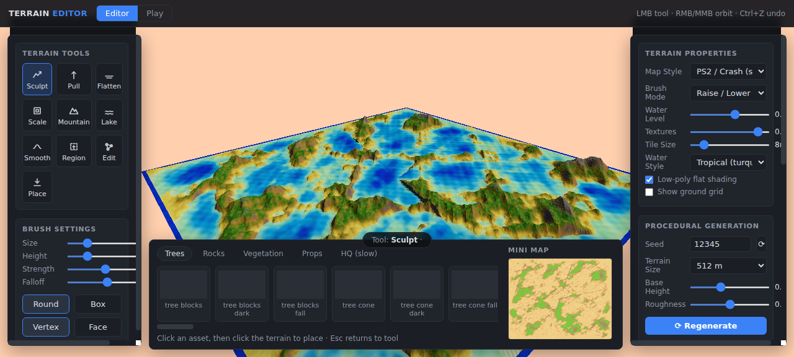

<div align="center">

<h1>Terrain Editor</h1>

<p>Low-poly terrain sculpting in the browser — no build step, no install.</p>

<p><a href="#quick-start">Quick start</a> · <a href="#controls">Controls</a> · <a href="#features">Features</a> · <a href="GAP-ASSETS.md">Missing-asset spec</a></p>

</div>

**Draw, scale and scatter a whole low-poly world in real time.** A heightfield
editor built on Three.js: brush the terrain like sculpting clay, place CC0
models with per-object density and size control, switch complete map styles,
and grab individual vertices or faces and move them by hand.



## Quick start

```bash
git clone https://github.com/OpenRootdev/terrain-editor.git
cd terrain-editor
python3 -m http.server 8901
```

Open <http://localhost:8901/> — that's it. Any static file server works;
`Start Terrain Editor.bat` does the same on Windows (Python required, no
npm/node anywhere).

Slow machine or software rendering? Add `?lite` to the URL.

## Controls

| Where | What it does |
|---|---|
| Left tools | Sculpt · Pull · Flatten · Scale · Mountain · Lake · Smooth · Region · **Edit** · Place |
| Brush settings | Size, Height, Strength, Falloff, round/box shape, raise/lower/toggle |
| **Edit tool** | Click = select a vertex, Shift+click = add, drag up/down = move (toggle **Vertex / Face** to grab whole quads; Esc clears, Ctrl+Z undoes) |
| Right panel | Water level & styles, map styles, textures/tile size, procedural regenerate |
| Bottom bar | Asset tabs; every variant gets a density-weight, size, count and randomize row |

**Map styles** set palette, scatter rules, water, sky and shading in one
switch: Stylized · PS2 / Crash (sunset) · Autumn · Desert · Winter · Volcanic.
Styles and the flat-color/textured modes share one rule set, so they always
agree.

## Features

- 10 terrain brushes + an editor-style vertex/face mover with undo.
- Procedural regenerate (seed, size, roughness) — mountains, lakes, islands.
- Weighted seeded scatter: per-asset density, size, counts, reshuffle; a 4th
  pool lets huts/ruins litter the map like trees do.
- Depth-graded water with three color styles, shore foam and scrolling ripples.
- Height-respecting layered materials (sand → dirt → grass → rock → snow)
  with a stochastic blocky snow line; textured mode blends four CC0 textures.
- 213 bundled CC0 models (Kenney Nature Kit, 3TD tropical/ruins packs,
  Modular Temple, Poly Haven HQ) — flat, local, instant.
- Diagnostics exposed on `window.__editor` for scripted testing.

## Adding assets

Drop a GLB into `web/assets/lp/` and list it in
`web/assets/lp/manifest.json` (category: `trees` / `rocks` / `vegetation` /
`props`) — tile, weight row and scatter participation follow automatically.
`tools/convert_dae.py` and `tools/convert_packs.py` convert OBJ/DAE packs
the same way. What's still missing, with generation prompts, lives in
[GAP-ASSETS.md](GAP-ASSETS.md).

## Status & limitations

Public v1 — brush/scatter/styles/edit all working and browser-verified.
Honest known issues: texture tiles repeat at far zoom, no save/load of
scenes yet (undo within a session only), style switches apply scatter
weights on the next Scatter press. Full reference: [docs/REFERENCE.md](docs/REFERENCE.md).

## Credits

- [three.js](https://threejs.org) (MIT), vendored r170
- [Kenney Nature Kit](https://kenney.nl) — CC0
- 3TD Tropical Environment & Fantasy Ruins packs (Ron Kapaun) via
  OpenGameArt — CC0
- Modular Temple (Fertile Soil) via OpenGameArt — CC0
- Poly Haven HQ models/textures — CC0

## License

Code under [Apache License 2.0](LICENSE); bundled assets are CC0.
